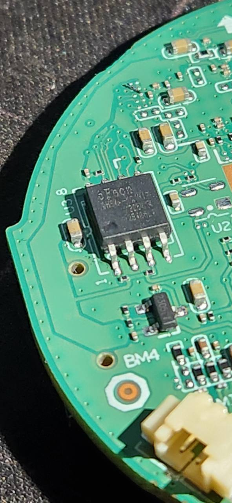
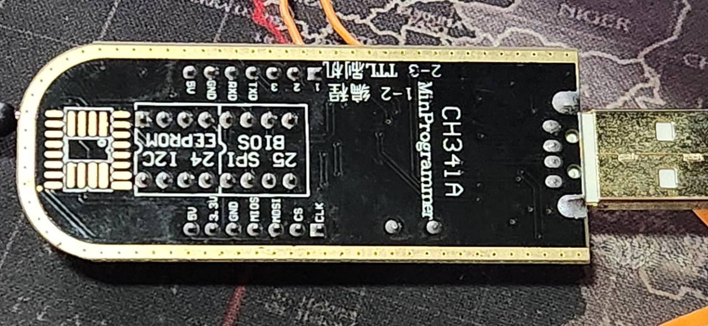
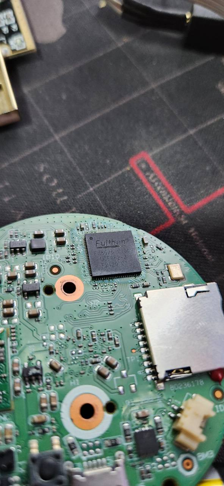

# Hardware: a dificuldade de ler e regravar a memória

## Memória e programador utilizados

O componente investigado foi uma memória **SPI NOR de 64 Mbit, equivalente a 8 MiB**, em encapsulamento de oito terminais. SPI é a interface de comunicação; NOR identifica o tipo de memória. Não se tratou de NAND.

| Item | Identificação registrada |
|---|---|
| Memória | SPI NOR, 64 Mbit / 8 MiB |
| Marca visível | cFeon |
| Identificação JEDEC obtida | `1C7017` |
| Referência técnica utilizada | Família EN25QH64A |
| Programador | CH341A USB, com pinça para o encapsulamento de oito terminais |

A marcação fotográfica é parcialmente legível. EN25QH64A foi a referência usada na validação, mas o sufixo exato do componente não está confirmado pelas imagens. Capacidade, identificação eletrônica e aparência precisam ser avaliadas em conjunto; não se deve selecionar uma memória apenas pelo nome comercial da câmera.

*Detalhe original da memória e da serigrafia da placa. A imagem permite observar o encapsulamento; não comprova sozinha o código completo do componente ou as condições elétricas da montagem.*

## O que dificultou o trabalho

O primeiro obstáculo foi distinguir o programador reconhecido pelo computador de uma comunicação efetiva com a memória. Inicialmente houve falta de driver; depois de resolvida, a consulta ainda retornou uma identificação inválida, formada apenas por bytes `FF`.

Isso não foi interpretado como chip vazio nem como backup válido. Entre as hipóteses estavam contato da pinça, orientação, alimentação e interferência dos demais componentes ligados ao barramento.

A leitura em circuito pode envolver mais do que a memória: o trilho de alimentação e os sinais continuam conectados ao restante da placa. O reconhecimento USB não verifica essas condições.

*Vista do programador utilizado. A serigrafia não substitui medição de tensão. A unidade havia passado por uma modificação elétrica anterior, portanto a fotografia não é um esquema de ligação validado.*

## Intervenção no pino 8

Na montagem utilizada neste projeto, **foi necessário levantar e isolar temporariamente o pino 8, correspondente à alimentação VCC na pinagem da família de referência**, para realizar a validação com o programador externo. A intervenção física foi realizada pelo proprietário e registrada durante o trabalho.

Não foi simplesmente conectar a pinça e regravar. A necessidade de separar a alimentação do componente tornou a etapa física uma parte relevante da investigação.

Os registros confirmam o isolamento do pino durante as etapas de leitura e gravação e sua restauração posterior. Não há medição conclusiva que permita atribuir a falha inicial a um único mecanismo elétrico. Também não há base para afirmar que toda revisão da iMX-C exige essa intervenção.

As fotos apresentadas documentam os componentes, mas não mostram de forma conclusiva o pino levantado. Por isso não recebem uma indicação visual de intervenção que elas não comprovam.

O isolamento não era uma condição permanente de operação: a ligação original precisou ser restaurada, com o equipamento sem alimentação, antes do boot normal. O programador foi retirado antes de alimentar a câmera pela própria fonte.

## Como a etapa foi validada

1. Resolver a comunicação e obter uma identificação eletrônica estável.
2. Realizar leituras completas independentes e comparar seu conteúdo.
3. Preservar os backups e separar arquivos de trabalho dos originais.
4. Validar o candidato, incluindo seus limites de alteração e a preservação das regiões assinadas.
5. Conferir o estado anterior à escrita.
6. Realizar a alteração controlada e obter leitura completa posterior.
7. Comparar a leitura posterior com o candidato esperado.
8. Restaurar a montagem e verificar boot, autenticação e persistência no equipamento.

A leitura posterior idêntica demonstra a correspondência dos bytes naquele momento. A aceitação pelo firmware e o funcionamento dos serviços exigiram testes separados após o boot.

Também é importante distinguir a imagem imediatamente após a gravação do estado posterior: alterações feitas pelo gerenciador nativo podem atualizar a configuração persistente durante a operação.

## Vista da placa

*Vista da placa durante a investigação, com processador e slot de cartão. Não é um diagrama elétrico nem uma identificação de pinagem para outras revisões.*

## Lições práticas

- Resposta `FF` não prova que a memória está vazia.
- Driver instalado não comprova comunicação SPI.
- A pinça conectada não garante uma leitura estável em circuito.
- A tensão nominal da câmera não determina a tensão dos sinais da memória.
- O levantamento do pino 8 foi uma intervenção da montagem investigada, não uma instrução universal.
- Integridade dos bytes, boot e funcionamento da aplicação são verificações diferentes.

Antes de repetir uma intervenção física em outro equipamento, confirme componente, pinagem, níveis elétricos e possibilidade de recuperação. A fotografia de um programador não certifica a tensão que ele fornece.
