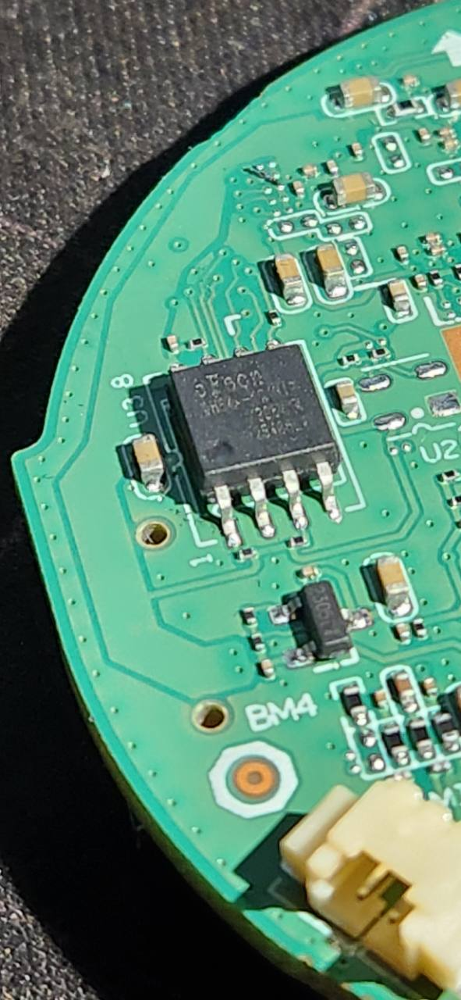

# Projeto IMXC: investigação de firmware e integração local de câmeras próprias

Prévia para revisão — 01/11/2026.

## Objetivo

Este projeto investigou a utilização local de câmeras Intelbras iMX-C associadas a uma plataforma de serviço, buscando integrar equipamentos próprios a um painel independente.

O problema inicial era conseguir utilizar os recursos locais das câmeras com autenticação válida, especialmente vídeo, áudio e gravações, sem depender do aplicativo da operadora para cada operação.

O trabalho reuniu investigação de firmware com REA, preservação e comparação de backups, estudo de configuração e autenticação, estabelecimento de acesso local autenticado, desenvolvimento de um painel web, implantação em servidor dedicado e validação funcional e de segurança.

Não foi desenvolvido um firmware completo substituto. O painel executa fora da câmera e utiliza serviços disponíveis no próprio equipamento.

## Papel do REA na investigação

O REA — Reverse Engineer Anything — foi integrado ao fluxo com o Codex para apoiar a exploração dos artefatos e a organização das evidências. A investigação foi orientada por perguntas técnicas:

- Quais componentes existem dentro do pacote de firmware?
- Qual é a arquitetura do executável principal?
- Onde estão as referências aos serviços de vídeo?
- Como o firmware carrega configurações persistentes?
- Como diferenciar inicialização, cadastro de conta e autenticação?
- Quais regiões são protegidas por verificações de integridade?
- Uma alteração estruturalmente válida seria aceita pelo verificador do equipamento?

O fluxo utilizou REA em conjunto com Binwalk, Unblob, ferramentas de extração de sistemas de arquivos e Ghidra.

```text
Artefato original → identificação e extração
→ localização de componentes e referências
→ análise de funções e estruturas → formulação de hipótese
→ verificação independente → teste controlado no equipamento
```

O REA ajudou a localizar e relacionar informações. Os resultados relevantes foram conferidos com hashes, comparações de arquivos, verificadores específicos e testes reais. Uma referência encontrada em um executável não foi considerada prova de funcionamento no aparelho.

## Conta local e permissões

O resultado registrado foi uma conta local autenticada nos serviços utilizados pela câmera. Isso não equivale à criação de um usuário Linux com `sudo`, usuário de shell ou acesso `root`.

No laboratório, a conta de análise foi mantida sem privilégios administrativos por `sudo`.

## Documentação

- [Histórico técnico e resultados](HISTORICO.md): etapas, correções, validações e limites.
- [Arquitetura do painel](ARQUITETURA.md): componentes, funcionalidades e implantação.
- [Metodologia para equipamentos próprios](METODOLOGIA.md): sequência de investigação e critérios de validação.
- [Exemplos fictícios de investigação](EXEMPLOS.md): localização de funções, comparação de caminhos e diagnóstico de diferenças de representação.
- [Hardware e dificuldade de leitura/gravação](HARDWARE.md): memória SPI NOR, programador CH341A, intervenção no pino 8 e fotografias da investigação.



Esta entrega é documental e não constitui um pacote instalável. Os resultados descrevem os equipamentos e versões investigados; não demonstram compatibilidade universal, ausência de vulnerabilidades ou segurança absoluta.
